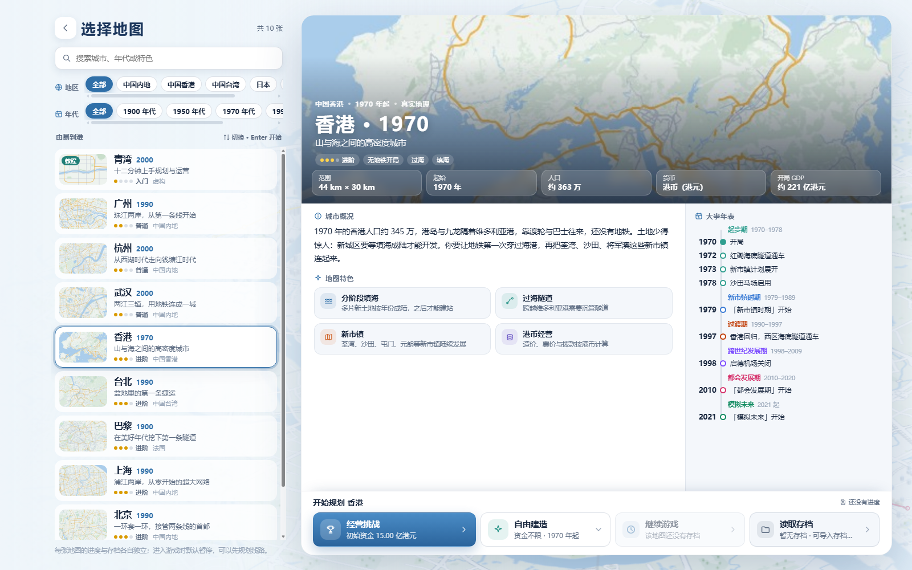
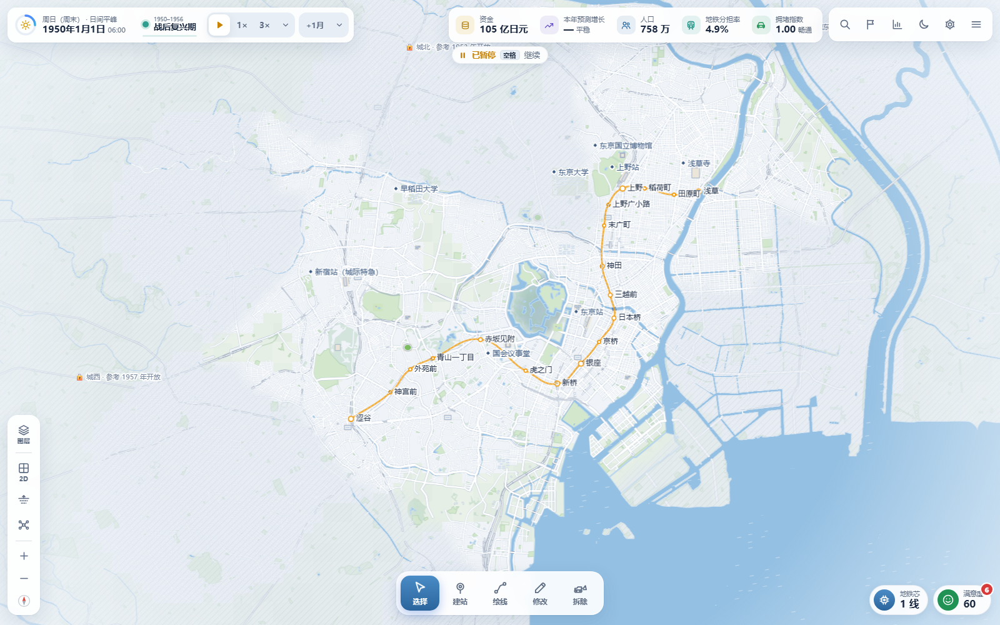
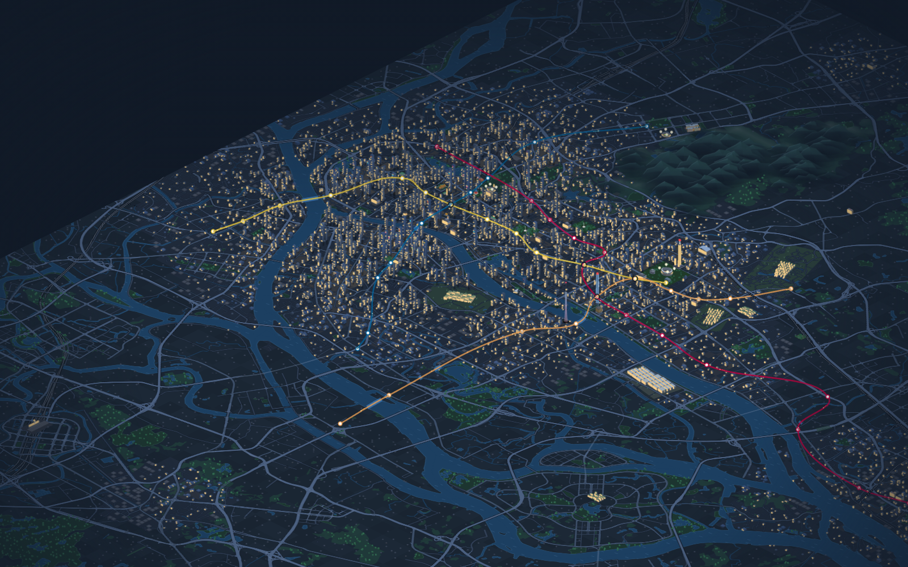
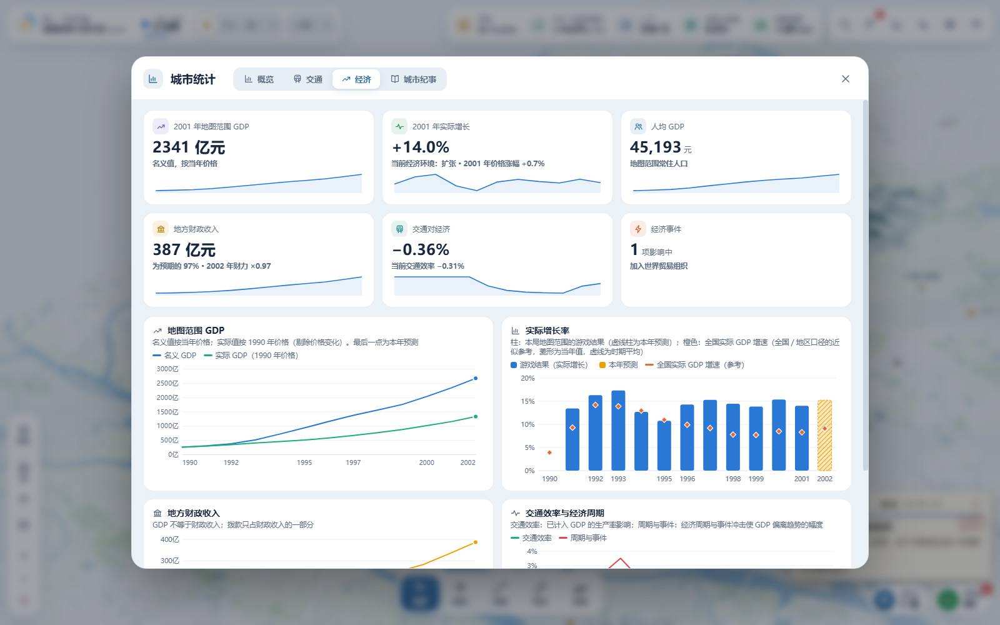
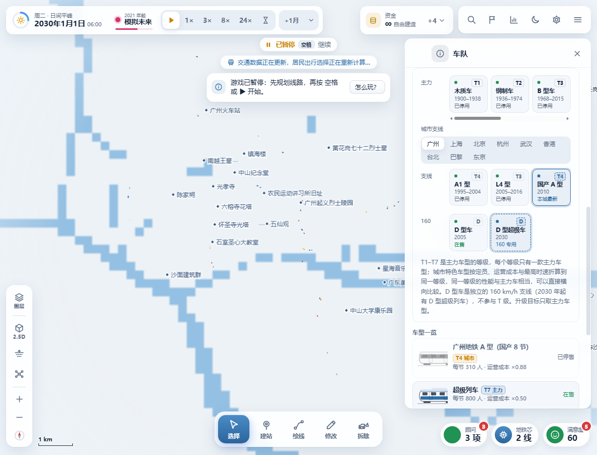
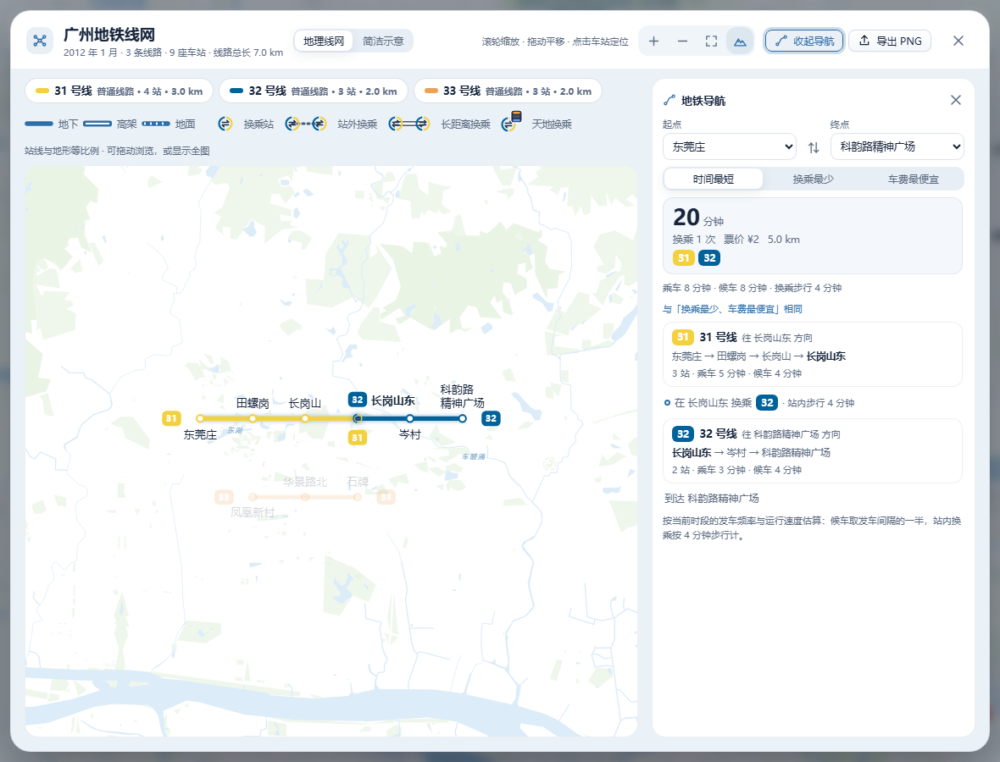

# 城市与地铁 · 社区修改版

**简体中文** · [繁體中文](./README.zh-TW.md) · [English](./README.en.md)

> **本仓库是社区修改版，不是官方版本。** 基于 [VinsonFung/city-and-metro](https://github.com/VinsonFung/city-and-metro) 修改；
> 原作者 [VinsonFung](https://github.com/VinsonFung) · 原版网站 [city-and-metro.pages.dev](https://city-and-metro.pages.dev)。
> 本分支在上下游基线 v2.5.1 之上继续开发到 **v5.5**（T1–T7 车型分级、超级列车、地铁导航、车站商业改造等），
> 改动清单见[本社区版新增](#本社区版新增v41--v55)。遵循[非商业许可](./LICENSE.txt)，**严禁商业使用**。

**在真实城市里，画出你自己的地铁。**

《城市与地铁》是一款在浏览器中游玩的单人地铁规划与城市经营游戏。从第一座车站开始，连接住区、商圈、校园与机场，跨过江河，逐步织出自己的交通网络。城市随年代发展，居民也会根据你的路网重新选择出行方式。

**[在线游玩](https://angelkoyou.github.io/city-and-metro-by-kuruu/)** · [本仓库](https://github.com/angelkoyou/city-and-metro-by-kuruu) · [原版网站](https://city-and-metro.pages.dev) · [使用许可](./LICENSE.txt)

上游基线为 **v2.5.1**：政府合同、商业盈亏、车队与调度、运行速度与交路，以及「地铁芯」线网管理系统；同步复合任务、建设平衡、分析工具、教程、声音、三语和性能修复。世界地图选城与城市转场保留为独立版专属功能。本社区版在此基础上继续开发到 **v5.5**，详见下一节。

## 本社区版新增（v4.1 – v5.5）

| 版本 | 改动 |
| --- | --- |
| v4.1 | 站台规模下限改为按「该时段实际运行列车的最大编组」动态决定，换乘站取所有过线线路的最大值 |
| v4.2 | 线路颜色可直接填色号（`#RRGGBB`、`#RGB`、`rgb()`、裸 `110,91,168`），打满 6 位立即生效 |
| v4.3 | 无限贷款下投标保证金可以透支，不再被现金余额挡住 |
| v4.4 / v4.5 | 车型准入统一为 `lineFit`；新增车站启用开关与预留换乘 |
| v4.6 | 运行速度取「轨道设计速度与该交路最慢车型限速」的较小值；交路独立客流与换乘提示 |
| v4.7 | 列车运营页交路卡片重排，交路名独占一行，窄侧栏不再竖排成一字一行 |
| v4.8 | 停用站与预留站视为不存在：不进停靠表、不停车不减速，端点折返自动前移到同侧最近站 |
| v4.9 | 每个运行车型都标出最高时速；列车列表改为两行网格排版 |
| v5.0 | 主力车型分级 **T1–T6**，一款一级；自动配置只补主力，城市特色车改为补差价升级 |
| v5.1 | 作弊设施新增「铁路客运站」与「汽车客运站」，与机场共用同一套枢纽接驳口径 |
| v5.2 | 车站商业批量开发改为「10 年内回本」口径，逐站取能回本的最高等级 |
| v5.3 | 线路示意图新增**地铁导航**：时间最短 / 换乘最少 / 车费最便宜三种方案，并高亮对应线路与换乘站 |
| v5.4 | 车站商业批量开发改成卡片：按钮跟着各自的说明与投入走，长规则折叠收起 |
| v5.5 | 科技树新增 **T7 超级列车**（2030，800 人/节，120 km/h）与 **D 型超级列车**（2030，双层 1000 人/节，160 km/h），运营成本均为基准的 0.5 倍 |

## 维护与社区版本

- **本仓库**：社区修改版，由 [angelkoyou](https://github.com/angelkoyou) 维护。问题与建议请开 [Issue](https://github.com/angelkoyou/city-and-metro-by-kuruu/issues)，欢迎 PR。
- **上游原版**：由原作者 [VinsonFung](https://github.com/VinsonFung) 维护，原版网站见 [city-and-metro.pages.dev](https://city-and-metro.pages.dev)。上游仓库不接受 PR，原版相关问题请到原仓库反馈。
- **署名**：本社区版完整保留原作者署名、许可证与第三方声明；在本版基础上再分发时，请一并保留并注明你的进一步修改。

**原版及社区改版均严禁商业使用。** 不得收费游玩、出售、投放广告、接受商业赞助或用于其他商业变现；免费发布、修改或改名不构成例外。请保留原有许可证、版权和第三方署名，清楚说明自己的修改，不要冒充官方版本。

## 你可以做什么

- **选择城市与年代。** 九座真实城市加一张青湾教程地图，各有地形、发展阶段与本地目标；自由建造还可以选择起始年份、解锁全图。
- **规划自己的路网。** 建设地下、地面和高架线路，设计曲线、环线、支线与分层换乘，调整站台方向，拆分或贯通线路。草案可以预览、撤销，确认后投入运营。
- **经营一座城市的地铁。** 选择无限资金，或在经营挑战中平衡建设、运营、票款、拨款与债务。用客流、拥堵、步行覆盖和建设效果报告判断下一步。
- **跟着城市一起发展。** 新城区、机场、校园和景区随年代启用，历史事件影响出行与经济；完成设施接驳任务，查看阶段总结和城市纪事。地图外机场在边界外显示方向、距离与客流，把线路接到边缘接驳口即可服务。
- **观察路网里的生活。** 在 2D、2.5D 与地下视图中切换，跟随列车进站，观察街头人车、城市地标与夜景。环境音随镜头所在区域变化。

- **让地铁改变城市。** 车站开通后，居民的出行习惯逐步转向地铁，新增人口和岗位更多地向站点聚集。用“拥堵变化”和“地铁带动”图层观察长期效果。
- **开发和装饰车站。** 建设广告与便利店、商业街、站城一体开发，增加非票务收入；为车站选择风格、主题色、公共艺术和标识。
- **听见乘客的反馈。** 在“地铁圈”查看与当前模拟数据对应的乘客动态、回复和满意度，关注市民，跨月观察变化。九城还提供 18 个可自行接受的城市规划难题。

- **管理车队与交路。** 43 款车型按城市和年代开放，可购买、调配和出售；按早高峰、平峰、晚高峰、夜间调度列车，环线可分方向安排。选择 40–120 km/h 线路速度，开行快车与区间车。
- **用地铁芯管理线网。** 在右下角打开总览、线路、车站和列车管理，筛选与排序表格，查看趋势、地图和改造预览；持续过载可定位或自动处理。
- **承担政府合同与经营风险。** 经营挑战达到条件后可投标新线 PPP、铁路＋物业和扩容项目，按建设与运营考核收款。车站商业计入维护成本与经济周期，低客流开发也可能亏损。
- **完成复合目标。** 新发布任务会同时考核网络、覆盖、运营、收支或发展；截止时主体达标可获部分奖励，停用设施的任务会撤销。旧任务保持原说明和进度。
- **使用十二种图层与四个工具。** 新增通勤时间、乘地铁比例、商业开发、测距、线路标注和任务标记；支持多选／框选拆除与一次撤销。

支持简体中文、繁体中文和 English，可在「设置 → 画面 → 界面语言」中切换。桌面与手机均有对应界面，触屏支持拖动和双指缩放。

进入地图时，城市大图作为载入背景，LOGO 沿笔画逐段绘成，车站依次亮起；下方线路进度条显示城市、交通与出行的准备进度，并跟随系统的减少动态效果设置。

## 游戏截图

以下四张截图截取自上游基线 **v2.5.0**（2026-11-04），使用隔离测试进度，不涉及玩家存档；本社区版新增功能的截图见[本节末尾](#本社区版新增界面)。

### 选择你的城市

十张地图各有简介、城市特色和分阶段年表，地区与年代筛选可左右拖动。下图为香港地图，包含扩展后的离岛与机场范围。

### 东京：从银座线开始

1950 年开局接管浅草—涩谷之间的银座线 18 站，在白天的 2D 地图中观察街区与既有路网。

### 广州：珠江两岸的夜景

2.5D 视图中的建筑、江面、地标与地铁线网。画面来自游戏内 2012 年的主菜单演示场景，已收起界面。

### 从路网看到城市经济

经济统计展示 GDP、增长、地方财政与交通效率。下图使用独立创建的广州自由建造演示进度：2000 年开局建成五站线路，再按正常结算推进两年至 2002 年。开局前的数据来自年代推演，数值均为游戏模拟结果。

### 本社区版新增界面

**科技树：T1–T7 主力车型与 160 支线的 D 型车。** 每款车分属一个等级，2030 年起解锁超级列车；右侧列出定员、时速与运营成本，价格由统一的车型价格模型算出。

**线路示意图里的地铁导航。** 点起点、点终点，按时间最短 / 换乘最少 / 车费最便宜各给一套方案；未选中的区间压暗，选中区间与换乘站高亮。

**车站商业批量开发。** 「全部开发」与「只开发 10 年内回本的站台」两个入口各自带一行投入与收益统计，长规则折叠在下方，没有候选站台时只留一句原因。

## 城市与开局

| 地图 | 默认起年 | 规划特色 |
| --- | --- | --- |
| 青湾 | 2000 | 虚构小城，13 步教程、约 12 分钟，无限资金 |
| 广州 | 1990 | 珠江两岸、老城与天河，向番禺和大学城发展 |
| 杭州 | 2000 | 西湖、钱塘江、跨江新城与萧山机场 |
| 香港 | 1970 | 山地海港、新市镇、填海与赤鱲角机场 |
| 台北 | 1990 | 盆地、三河与多中心发展 |
| 北京 | 1990 | 接管 1 号线与环线 29 站，连接环路、奥运场馆与副中心 |
| 东京 | 1950 | 接手银座线 18 站，连接副都心与羽田机场 |
| 上海 | 1990 | 黄浦江、浦东开发、世博会与迪士尼 |
| 武汉 | 2000 | 两江三镇、东湖、光谷与天河机场 |
| 巴黎 | 1900 | 百年城市变迁、跨城通勤与两大机场 |

九座真实城市均支持经营挑战与自由建造，使用对应城市和年代的货币、票价及经营参数。后来的真实地铁不会自动出现，线路由你规划。

## 运行与存档

打开[在线版](https://angelkoyou.github.io/city-and-metro-by-kuruu/)即可游玩。也可以下载本仓库，在桌面版 Chrome、Edge 或 Firefox 中打开 `index.html`，无需安装依赖或构建。

进度和设置保存在当前浏览器，无需账号。支持自动保存、手动保存、存档改名，以及 JSON 导入导出。更换电脑、浏览器或网址前，请先导出备份。未确认的建设草案不会保存。

支持的旧存档会在升级前保留原始备份，已有站线、票制、资金、债务和历史账目继续保留。载入失败时，可在存档列表导出原始数据。

## 常用操作

按键可在「设置 → 键位」中修改，游戏内提示会同步更新。

| 操作 | 默认方式 |
| --- | --- |
| 平移 / 缩放 | 左键拖动、WASD / 方向键；滚轮、`+` / `−` |
| 工具 | `V` 选择 · `B` 建站 · `L` 绘线 · `E` 修改 · `X` / `Delete` 拆除 · `O` 测距 |
| 绘线 | 依次点击；`Shift` + 点击添加转弯点；右键 / `Enter` 结束 |
| 批量拆除 | 拆除工具中 `Ctrl` 点击多选、`Shift` 拖动框选；`Enter` / `Delete` 执行 |
| 草案 | `Ctrl+Z` 撤销 · `Ctrl+Y` 重做 · `Ctrl+Enter` 确认建设 |
| 时间 | `空格` 暂停 / 继续；`1` / `2` / `3` / `4` 切换速度；`.` 推进一月 |
| 视图 | `T` 切换 2D / 2.5D · `U` 地下 · `K` 线网图 · `F` 全图 |
| 图层 / 沉浸 | `C` / `Shift+C` 切换分析图层 · `H` 隐藏 / 显示界面 |
| 常用入口 | `/` 搜索 · `J` 任务 · `G` 统计 · `Ctrl+S` 保存 · `F10` 设置 |
| 帮助 / 菜单 | `F1` 操作说明；`Esc` 暂停并打开菜单，弹窗内优先取消 / 返回 |

## 版权与许可

原始作品 **Copyright © 2026 VinsonFung。保留所有权利，严禁商业使用。**
本社区版自 v4.1 起的修改由 **angelkoyou** 完成，同样以非商业许可发布，不改变原始作品的版权归属。

非商业学习、研究、游玩、修改及分享须遵守 [LICENSE.txt](./LICENSE.txt)。第三方代码、数据与资源保留各自许可；OpenStreetMap 地理数据遵循 ODbL 1.0，详见[第三方声明](./THIRD_PARTY_NOTICES.txt)。
